# 新建文件夹

> 一个假装成操作系统的整蛊小游戏。目标永远只有一个：**新建一个文件夹**。
> 但桌面会越来越不配合……到后来，整个游戏都开始不配合。

**版本 v0.4** · 20 关 · 第三幕「第四面墙」· 选关模式 · 真结局

纯静态、零依赖、全程序生成的矢量画面与合成音效，浏览器直接开玩。
支持 Chrome / Edge 111+（桌面端，需要鼠标 + 键盘）。

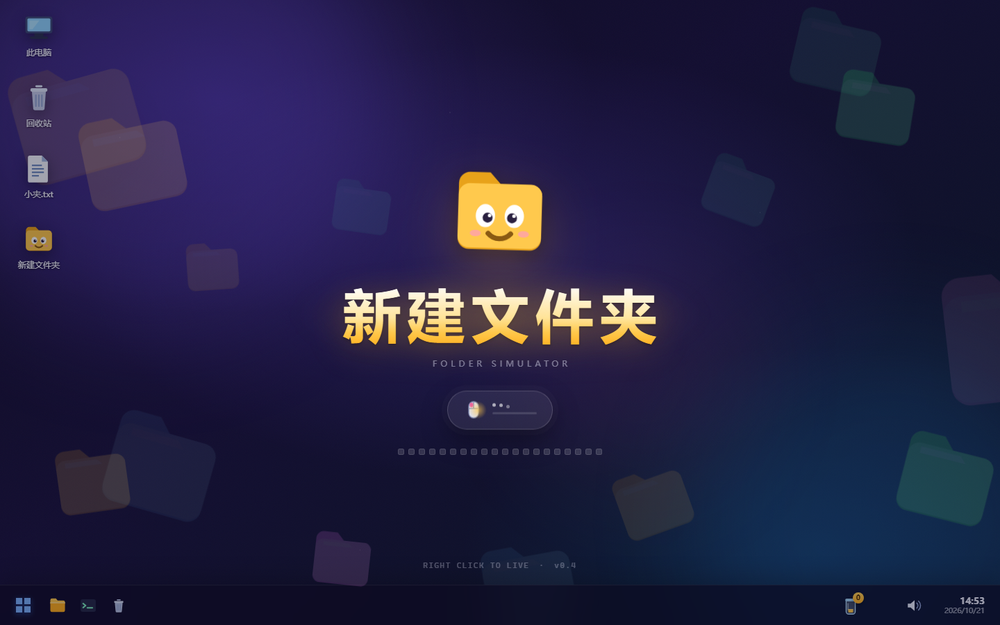

| | |
| --- | --- |
| 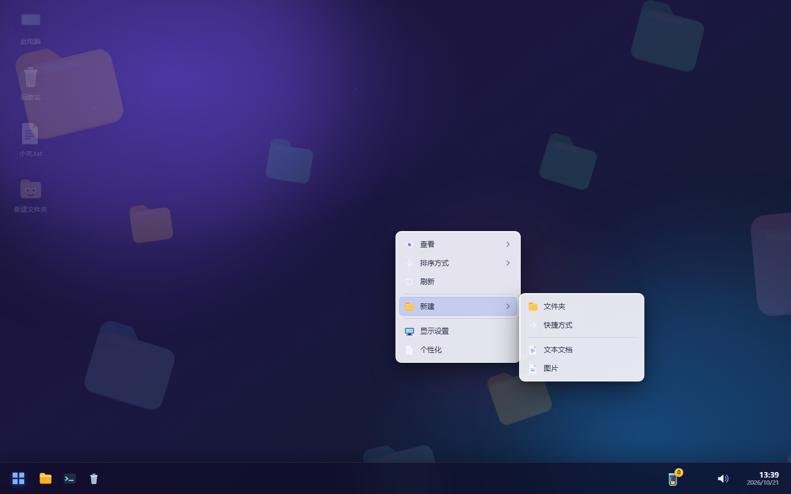 | 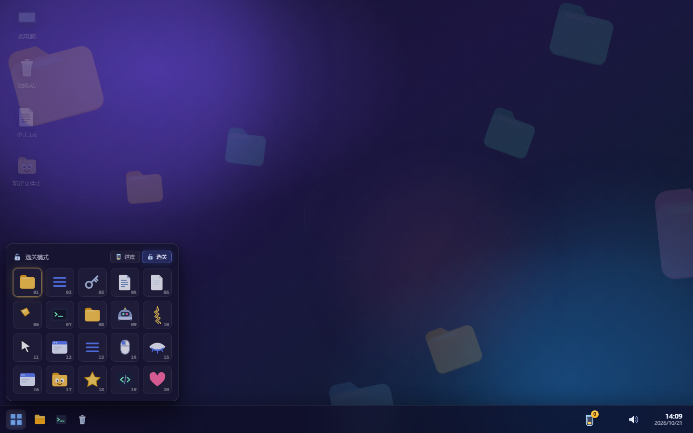 |
| 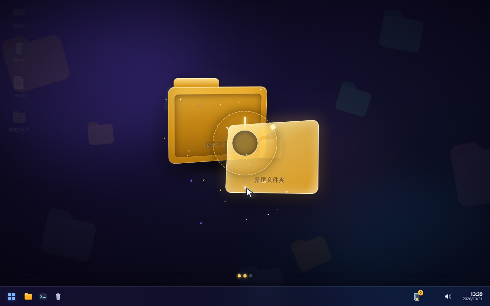 | 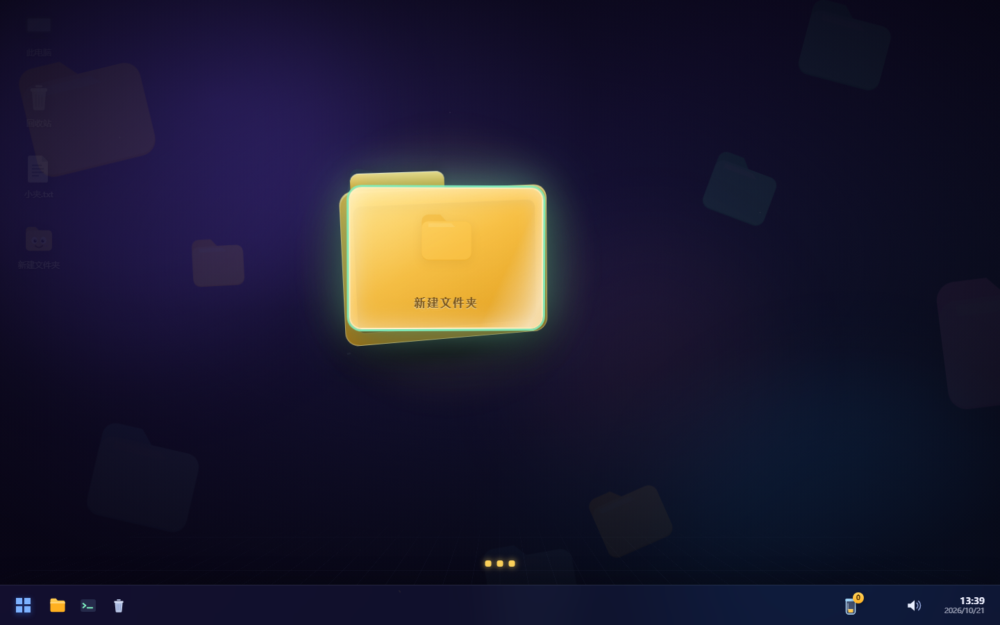 |
| 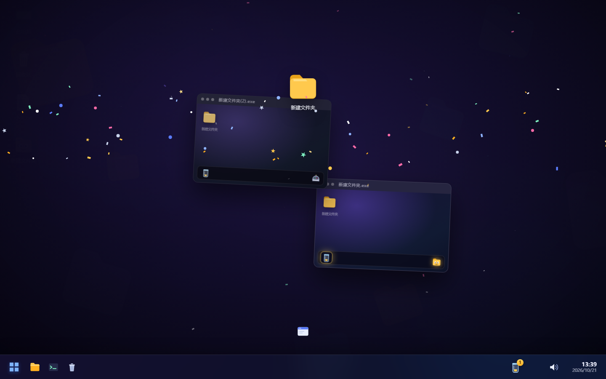 | 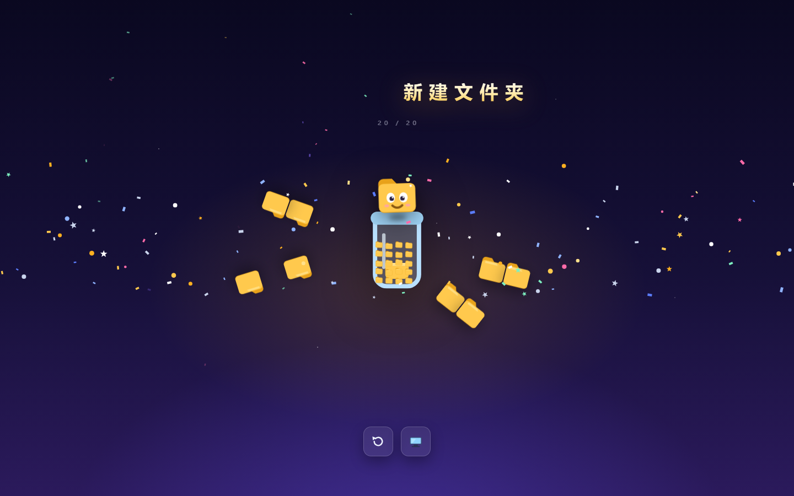 |

第三幕 · 第四面墙：

| | |
| --- | --- |
| 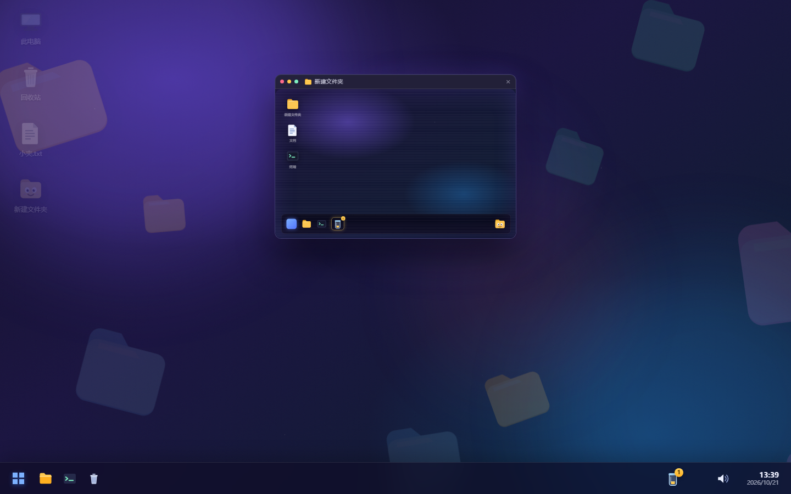 | 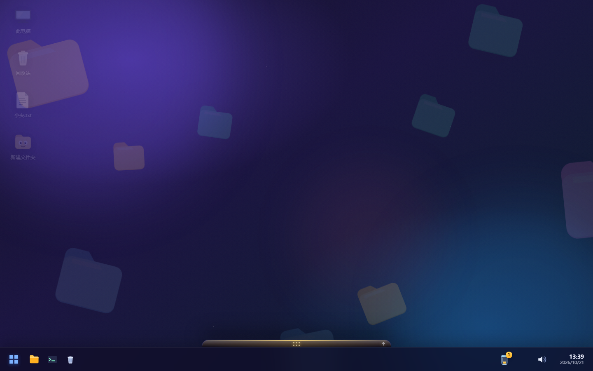 |
| 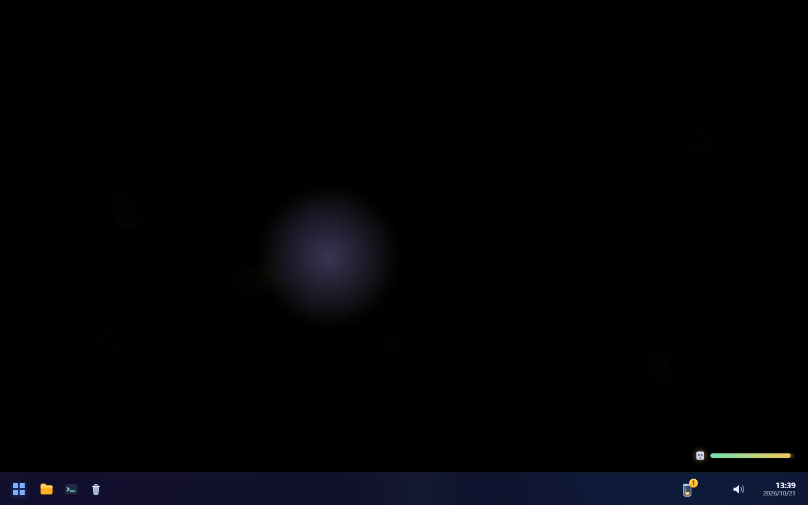 | 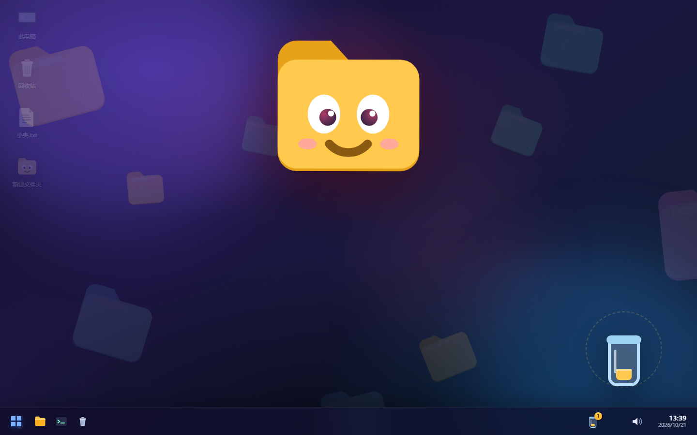 |
| 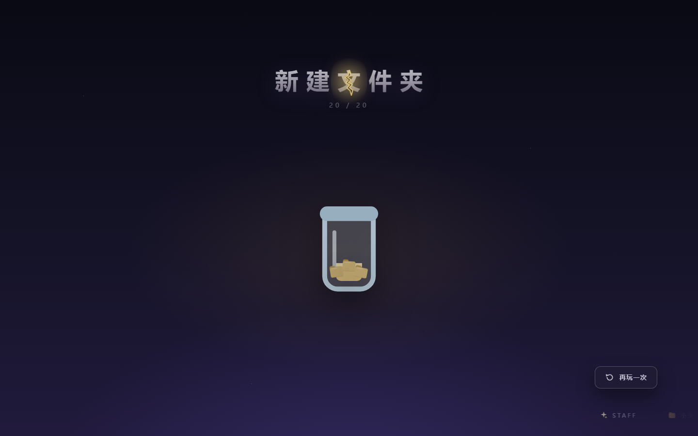 | 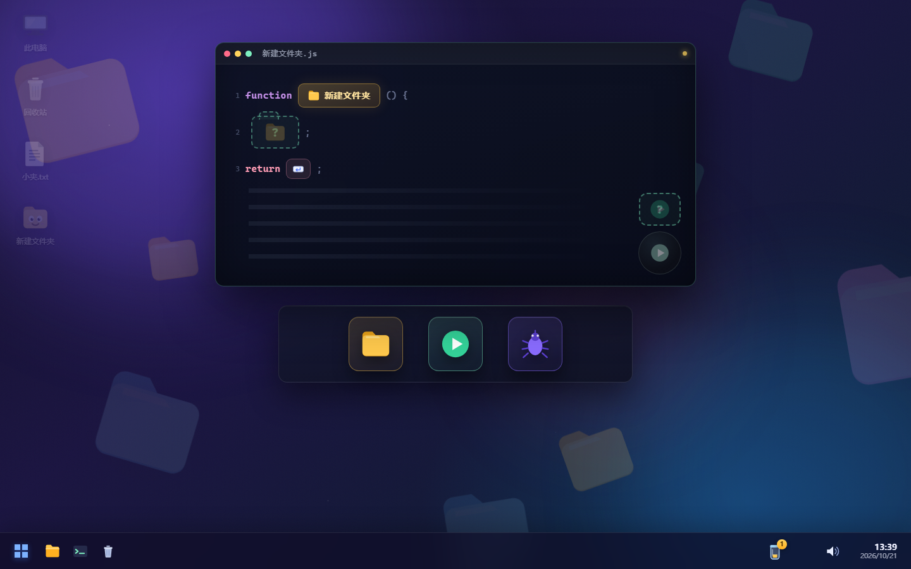 |
| 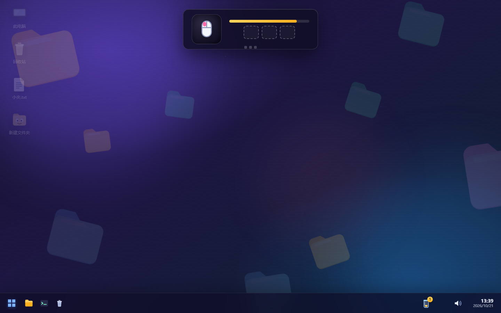 | 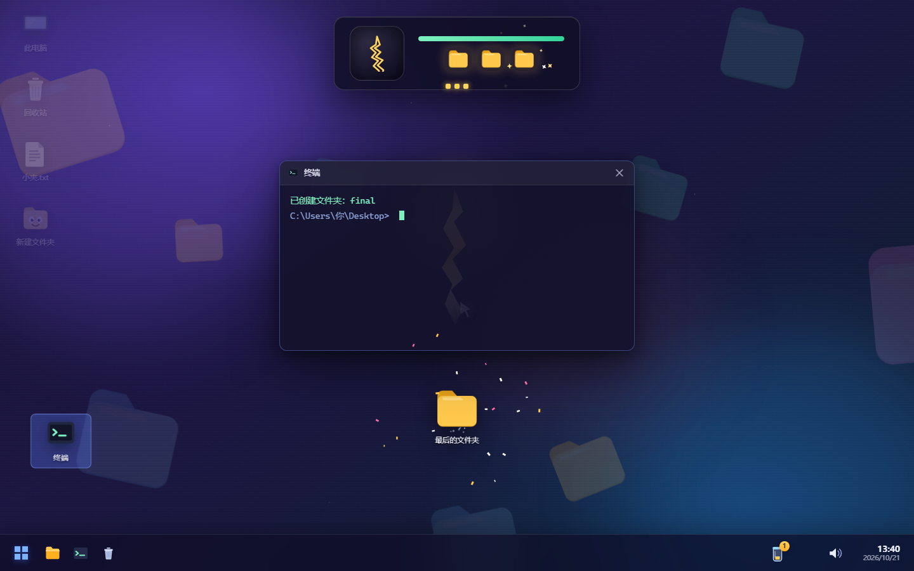 |

## 立即开玩

方式一（最省事）：双击 `dist/新建文件夹.html`。

方式二（开发/调试）：

```bash
node server.mjs 4173
# 浏览器打开 http://127.0.0.1:4173/
```

方式三：`npm start`（等价于上面那条命令）。

重新构建单文件版：

```bash
node build.mjs        # 生成 dist/新建文件夹.html 与 dist/index.html
```

## 怎么玩

- 全程**没有说明书**：每关开场会有一个半透明"幽灵鼠标"把手势演示一遍。
- 卡住时，点任务栏的**灯泡**，或干脆发呆 12 秒，幽灵会再演示一次。
- 点任务栏**开始按钮**打开「选关模式」：20 关全部解锁，想练哪关点哪关；右上角可切换「进度」。
- 点任务栏右侧的**玻璃罐**打开「进度」地图：按通关进度解锁，收集到的文件夹都在罐子里。
- 点**喇叭**静音；进度自动保存在浏览器里，刷新会从上次的关卡继续。
- 每一关的目标都是"新建文件夹"，但达成方式各不相同。失败没有惩罚，只有整蛊。

## 关卡一览（不剧透）

| # | 标题 | 你大概要学会的事 |
|---|------|------------------|
| 01 | 右键入门 | 右键能干什么 |
| 02 | 菜单大逃亡 | 鼠标失灵时还有键盘 |
| 03 | 快捷键 | 有些门是有快捷键的 |
| 04 | 命名地狱 | 名字太长会出人命 |
| 05 | 拖拽合体 | 文件叠在一起会发生什么 |
| 06 | 碎片重组 | 文件夹是可以拼的 |
| 07 | 命令行 | 黑框框也可以建文件夹 |
| 08 | 三维折叠 | 对齐卡扣、压住会自己弹开的文件夹 |
| 09 | 清理大师 | 建好之后，还得抢在机器人前面 |
| 10 | 递归裂缝 | 文件夹装下自己之后，游戏被折叠了 |

**第三幕 · 第四面墙（11-20）**

| # | 标题 | 这次系统又发什么疯 |
|---|------|--------------------|
| 11 | 幽灵出逃 | 教程幽灵偷了"新建"命令 |
| 12 | 游戏里的游戏 | 在一个小游戏窗口里建文件夹，再把它拖出来 |
| 13 | 任务栏抽屉 | 新建入口藏在任务栏的暗格里 |
| 14 | 影子玩家 | 另一个"玩家"来抢你的文件夹 |
| 15 | 断电 | 屏幕只剩鼠标周围一圈手电光 |
| 16 | 窗口大逃亡 | 对话框逃到屏幕外面去了 |
| 17 | 小夹的凝视 | 它睁眼的时候，你点不了任何东西 |
| 18 | 假结局 | 游戏想提前骗你通关 |
| 19 | 源代码 | 创建文件夹的那行代码坏了 |
| 20 | 最终考试 | 三种方法、三轮限时，然后打碎第四面墙 |

## 项目结构

```
index.html            入口（源码版，按顺序加载 css/js）
css/style.css         伪 Win11 桌面主题 / 菜单 / 对话框 / 幽灵鼠标 / 结局
js/core/icons.js      全部内联 SVG 图标
js/core/audio.js      WebAudio 实时合成音效（无音频文件）
js/core/fx.js         Canvas 粒子 / 纸屑 / 震屏 / 飞行
js/core/ghost.js      幽灵鼠标教学演示引擎
js/core/os.js         右键菜单 / 对话框 / 窗口 / 桌面图标 / 拖拽 / Toast
js/core/game.js       关卡生命周期 / 进度 / 标题 / 任务栏 / 结局
js/levels/l01..l20.js 二十个关卡（各自注入自己的 CSS）
js/main.js            启动
server.mjs            零依赖静态服务器
build.mjs             单文件打包
docs/ENGINE.md        工程与关卡编写契约
qa/                   无头浏览器自动化测试（Playwright 无关，纯 CDP）
dist/                 构建产物（可直接双击）
```

## 测试

```bash
node qa/playtest.mjs            # 无头 Edge 逐关真实鼠标键盘通关 + 截图 + 结构化报告
node qa/selftest.mjs            # 测试基建自检
```

报告输出到 `qa/playtest-report.json`，截图在 `qa/shots/`。

## 技术备注

- 无任何外部图片/字体/音频/依赖，全部由 SVG、CSS、Canvas 与 WebAudio 实时生成。
- 字体使用系统字体（Microsoft YaHei / PingFang SC 等），离线也能玩。
- 3D 关卡使用 CSS 3D transform + perspective，不依赖 WebGL。
- 单文件构建会把所有 `<script src>` / `<link rel=stylesheet>` 内联，`file://` 下可直接运行。
- 第 10 关之后进入"第四面墙"幕：任务栏会开始偶尔抽风，第 20 关后才是真结局。

---

_all folders were harmed in the making of this game._
